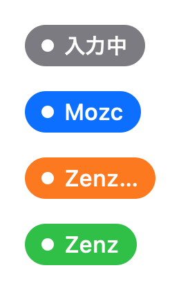
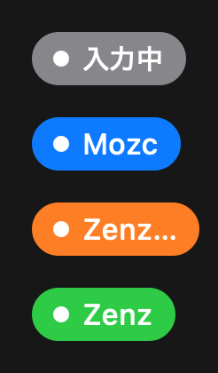

# Nagi の使い方と開発

対象は Apple Silicon の Mac です。

## ビルド

Xcode、Bazelisk、CMake、Python 3 が必要です。

```sh
cd src
python3 build_tools/update_deps.py
python3 build_tools/build_qt.py --release --confirm_license
bazelisk build package --config release_build
```

パッケージは `src/bazel-bin/mac/Nagi.pkg` にできます。

ヘッダー(`.h`)を書き換えたあとは、ビルドの前に次を実行してください。この環境では、ヘッダーの変更だけでは再コンパイルされないことがあります(経緯は [decisions.md](decisions.md))。

```sh
cd src
find -L bazel-out/ -path '*/_objs/*' -name '*.o' -not -path '*/external/*' -delete
```

## インストール

1. `src/bazel-bin/mac/Nagi.pkg` を開き、案内に従ってインストールします。署名のないパッケージなので、開けないときは「システム設定 → プライバシーとセキュリティ」で「このまま開く」を選びます。
2. ログアウトして、ログインし直します。
3. 「システム設定 → キーボード → テキスト入力 → 編集」で、「+」→「日本語」から Nagi の「ひらがな」を追加します。
4. メニューバーの入力メニューから Nagi を選びます。

Nagi は、名前、識別子、インストール先、設定フォルダを Mozc や Mozkey と分けてあります。同じ Mac に並べて入れられます。

| 項目 | Nagi の値 |
|---|---|
| アプリ | `/Library/Input Methods/Nagi.app` |
| 識別子 | `org.nagi.inputmethod.Japanese` |
| 常駐設定 | `/Library/LaunchAgents/org.nagi.inputmethod.Japanese.*.plist` |
| 設定フォルダ | `~/Library/Application Support/Nagi` |

取り除くときは、`/Applications/Nagi/UninstallNagi.app` を使います。

## Zenz の準備

Zenz を使うには、モデルと実行環境を設定フォルダに置きます。次のスクリプトが、パッチを当てた llama-server のビルドと、モデルの取得を行います。

```sh
sh src/mac/zenz_runtime/setup_zenz_runtime.sh
```

置かれるのは次の 2 つです。

- `~/Library/Application Support/Nagi/zenz/llama-server`
- `~/Library/Application Support/Nagi/zenz/model.gguf`

Zenz のモデルは、素の llama.cpp が知らないトークナイザ名を使っています。そのため、1 行のパッチを当ててビルドします。パッチと固定している版は Mozkey に合わせています。モデル(zenz-v3.2-small)のライセンスは Apache License 2.0 です。

これらがないときは、Zenz を有効にしても問い合わせは行われず、Mozc の変換だけが表示されます。

## 辞書を強化する

Mozc の標準辞書に、Mozkey が配布版で足している辞書を加えられます。

```sh
zsh tools/dictionary/prepare_dictionary.sh   # 辞書を作る(約 50MB を取得、数分)
zsh tools/nagi_dev_install.sh                # ビルドして入れ直す
```

| 足すもの | 取り込み元 | 語数 |
|---|---|---|
| 地名と一般語彙 | mozcdic-ut-place-names、mozcdic-ut-sudachidict | 約 108 万 |
| 人名 | mozcdic-ut-personal-names | 約 5.4 万 |
| ネット・サブカルの固有名詞 | dic-nico-intersection-pixiv | 約 4.9 万 |
| 区切りの崩れを防ぐ語 | Mozkey の生成スクリプト | 537 |

- 取得元の版とハッシュ、絞り込み、検査は、どれも Mozkey v1.1.0 のものをそのまま使います。Nagi 側にあるのは、その手順を Mac で動かすスクリプトだけです。
- 作った辞書は `src/data/dictionary_nagi/generated/` に置かれ、リポジトリには入りません。配布物に含めるときは、Mozkey の `src/data/installer/DICTIONARY_NOTICES.md` にある出典とライセンスの表記が必要です。
- 元に戻すには、`src/data/dictionary_nagi/generated/*.txt` を消してビルドし直します。
- 辞書がないときは、Mozc の標準辞書だけでビルドされます。

## 開発中の更新

一度インストールしたあとは、次の 1 行でビルド、上書きインストール、プロセスの再起動まで行えます。ログアウトも、入力ソースの追加し直しも要りません。途中で管理者のパスワードを聞かれます。

```sh
zsh tools/nagi_dev_install.sh
```

入力モードの定義やメニューバーのアイコン(`src/mac/Info.plist`)を変えたときだけは、ログアウトが必要です。

## 設定

新しい機能は、どれも既定でオンです。入力メニューの「環境設定」を開き、「ライブ変換」のタブで変えられます。

| 項目 | 既定 | 内容 |
|---|---|---|
| 入力しながら自動で変換する(ライブ変換) | オン | スペースキーを押す前に変換する |
| ライブ変換を始めるまでの待ち時間 | 228 ミリ秒 | 最後のキーから変換までの時間 |
| ライブ変換を始める最小の文字数 | 2 | 読みがこれより短い間は変換しない |
| 変換の状態を入力中の文字の近くに表示する | オン | 状態インジケータ |
| ライブ変換を Zenz で補正する | オン | ライブ変換が前提 |
| Zenz に問い合わせるまでの待ち時間 | 500 ミリ秒 | Mozc の変換が出てから問い合わせるまでの時間 |
| 初回の変換操作で候補ウィンドウを開く | オン | ライブ変換がオフのときだけ効く。オンのときは、変換済みの文字に Space を押すと候補が開く |

## ライブ変換中のキー

| キー | 動き |
|---|---|
| 文字 | 続きを入力する。表示はいったん読みに戻り、待ち時間のあとに変換し直す |
| Backspace / Delete | 読みを 1 文字消す |
| Enter | 表示されている文字で確定する |
| Space | Mozc の通常の変換に移る。Zenz の補正が出ているときは、Mozc の変換に戻る |
| Esc | 読み(かな)に戻す。読みを変えるまで、自動では変換し直さない |

## 打ち続けたときの表示

ライブ変換のあとに続きを打つと、変換済みの部分はそのまま残り、新しく打ったかなが後ろに付きます。手を止めると、全体をもう一度変換します。

- 残すのは文節の単位です。Backspace などで読みが変わった文節と、それより後ろは、かなに戻ります。
- この状態で Enter を押すと、画面に見えている文字がそのまま確定されます。

## ライブ変換中のサジェスト

ライブ変換の表示中も、打っている途中に出ていたサジェストはそのまま残ります。Tab で選べます。Space は、Mozc の通常の変換(文節ごとの候補)に移ります。

## 状態インジケータ

| 表示 | 意味 |
|---|---|
| 入力中 | 読みが短く、まだ変換の対象になっていない |
| Mozc | Mozc が変換した、または打ち終わりを待って変換するところ。Zenz が同じ結果を返したときも、ここで終わる |
| Zenz… | Zenz に問い合わせる予定、または問い合わせ中。待ち時間のあいだも出る |
| Zenz | Zenz が Mozc の変換を書き換えた |

Space や Tab で候補を選んでいるあいだは、インジケータを出しません。表示の決まりは Mozkey に合わせています。

 

## インストールせずに確かめる

実際の辞書と Zenz でキー入力を流し、表示の変化と時間を出力できます。設定や履歴は一時フォルダに書くので、ふだんの設定には触りません。

```sh
cd src
bazelisk run //session:nagi_typing_main --config release_build -- kyouhaiitenkidesu
```

```
== kyouhaiitenkidesu
     0ms  入力中	きょうはいいてんきです
   211ms  Zenz…	今日はいい天気です
   250ms  Zenz	今日はいい天気です
  commit  今日はいい天気です  (2 callbacks)
```

Zenz だけを試すときは次を使います。

```sh
bazelisk run //zenz:zenz_client_main --config release_build -- きょうはいいてんきです
```

## テスト

```sh
cd src
bazelisk test //config/... //session/... //mac/... //client/... //engine/... //zenz/... --config release_build
```

`//gui/...` と `//protocol/...` は、この環境ではテストとしてビルドできません(Qt のリンクと Java が必要)。パッケージのビルドでは、どちらもコンパイルされます。

## 今の制限

- **Zenz の結果が Mozc より悪いことがあります。** 採用の条件は「かなが読みと同じ順に含まれること」だけです。漢字の選び方までは確かめていません。Space で Mozc の変換に戻せます。
- **Zenz で確定した文字は学習されません。** Mozc の履歴に入るのは、Mozc の変換で確定したものだけです。
- **Zenz の実行環境はパッケージに入っていません。** 上のスクリプトで別に用意します。
- **英字の自動判定は未着手です。** 文中の英語をそのまま打てるようにする「自動入力」は、これから設計します。
- **実機での確認は、まだ十分ではありません。** インジケータの位置、アプリごとの挙動、設定画面の見た目は、テストでは確かめられていません。
